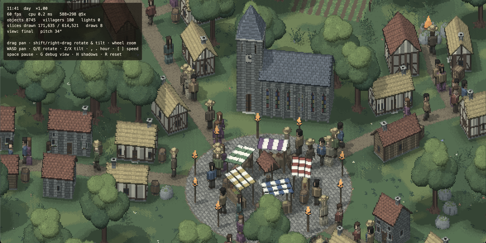

# pixel-art-poc

A proof of concept for a pixel-art engine. It procedurally generates a medieval village and renders it as **sprite stacks**: every object is a pile of flat, horizontal image slices. The scene is lit by a deferred renderer that does a day/night cycle, cel-banded shading, heightfield shadows, and many flickering point lights at night. Selectable weather (from clear through rain and thunderstorms to snow and blizzards) changes the light, wets or snows over the surfaces, bends the vegetation and sends villagers indoors, with procedural sound. The whole frame is rendered at low resolution and upscaled with nearest-neighbour filtering, so each art pixel stays crisp.

TypeScript + raw WebGL2. No engine, no runtime dependencies.

### Demo



```sh
npm install
npm run dev        # Vite dev server
npm run typecheck
```

### Controls

| Input | Action |
|---|---|
| drag / WASD / arrows | pan |
| shift-drag or right-drag | rotate (horizontal) and tilt (vertical) |
| Q / E | rotate |
| Z / X | tilt camera lower / higher |
| wheel, `+` / `-` | zoom (integer scale, 1–8×) |
| `,` / `.` | hour back / forward |
| `[` / `]` | halve / double day speed |
| space | pause the clock |
| G | cycle debug views: final → albedo → normals → height → sun shadow → light only |
| H | toggle shadows |
| C / shift+C | next / previous crowd density |
| R | reset camera |
| **weather** dropdown (top right) | Clear, Cloudy, Overcast, Fog, Light rain, Rain, Thunderstorm, Light snow, Snow, Blizzard. Changes crossfade over a few seconds |
| **crowd** button | cycle villager density: none → sparse (35%) → normal → busy (2.5×) → crowded (5×), relative to the `villagers` count. Changes apply instantly |
| **sound** button | mute / unmute the procedural weather audio (audio starts after the first click or key press) |

### URL parameters

`seed` (village layout, default 7), `villagers` (count at normal density, default 180; 5× that are allocated for the crowded level), `crowd` (starting density, 0–4, default 2 = normal), `t` (start hour), `speed` (game hours per real second), `weather` (starting preset id: `clear`, `fog`, `rain`, …), `paused`, `zoom`, `pitch` (degrees), `rot` (radians), `x` / `y` (camera position), `debug` (debug view index), `noshadows`, `capture` (preserve the drawing buffer for screenshots).

Example: `/?seed=42&t=20&pitch=45&villagers=2000`

---

## How it works

The rest of this document explains the rendering technique and the maths behind it. It follows the order the data flows through the program.

```
 startup (CPU, once)                                    per frame
 ───────────────────                                    ─────────
 models.ts   voxel models ─┐                            weather.update(dt) ─► thunder ─► weatherAudio
                           ├─ atlas.ts ─► slice atlas ─┐ villagers.update(dt, shelter)
 village.ts  placements, ──┘   (albedo + normal)       │        │
             ground texture, lights, road graph, ──────┼─► Renderer.render
             doors, chimneys                           │   1. heightmap   (top-down, MAX blend)
                                                       │   2. G-buffer    (instanced slices, depth test, wind sway)
 daycycle.ts hour ─► sun/moon dir, colours ─┐          │   3. lighting    (full-screen pass, + weather)
 weather.ts  ─► folded into the lighting ───┴──────────┘   4. effects     (smoke, rain, snow, lightning)
                                                           5. blit        (nearest-neighbour upscale)
```

| File | Role |
|---|---|
| [src/main.ts](src/main.ts) | Startup, input, camera, frame loop, HUD |
| [src/engine/renderer.ts](src/engine/renderer.ts) | The five render passes, culling, chunked instance buffers |
| [src/engine/shaders.ts](src/engine/shaders.ts) | All GLSL; the projection is documented at the top |
| [src/engine/gl.ts](src/engine/gl.ts) | Thin WebGL2 helpers (shader, program, texture, framebuffer) |
| [src/engine/rng.ts](src/engine/rng.ts) | Seeded PRNG, integer hash, value noise, fBm |
| [src/assets/voxel.ts](src/assets/voxel.ts) | `VoxelModel` authoring grid, material ids, `DETAIL` |
| [src/assets/models.ts](src/assets/models.ts) | Procedural models (houses, church, trees, props, villagers) |
| [src/assets/atlas.ts](src/assets/atlas.ts) | Voxels → slice images packed into albedo and normal atlases |
| [src/assets/library.ts](src/assets/library.ts) | Builds every model variant once and packs the atlas |
| [src/world/village.ts](src/world/village.ts) | Procedural village layout and ground texture |
| [src/world/daycycle.ts](src/world/daycycle.ts) | Time of day → light direction and colours |
| [src/world/weather.ts](src/world/weather.ts) | Weather presets, crossfade, wetness/snow cover, wind, lightning |
| [src/sim/villagers.ts](src/sim/villagers.ts) | Villagers walking the road graph, sheltering indoors in bad weather |
| [src/audio/weatherAudio.ts](src/audio/weatherAudio.ts) | Procedural WebAudio: rain, wind, thunder |

### Coordinate conventions

- World axes: **+x east, +y south, +z up**. At camera rotation 0, +y points down the screen (towards the viewer).
- One **world unit** is the layout unit. Positions, sizes and speeds use it.
- `DETAIL = 2` is the **art resolution**: voxels per world unit, which is also screen pixels per world unit at 1× zoom. Models and the ground texture are authored on this finer grid. A voxel is ½ world unit.
- A model's front faces +y. A placement's `angle` rotates it about its centre with the standard 2D rotation

```math
R(a)\begin{pmatrix}x\\y\end{pmatrix} = \begin{pmatrix}x\cos a - y\sin a\\ x\sin a + y\cos a\end{pmatrix}
```

  The same rotation is used on the CPU (`rot` in village.ts) and in the shaders. To turn a model's front $(0,1)$ to face a direction $(f_x, f_y)$, solve $R(a)(0,1) = (-\sin a, \cos a) = (f_x, f_y)$, which gives `facing(fx, fy) = atan2(-fx, fy)`.

---

## 1. Sprite stacking

A sprite stack draws a 3D object as a pile of 2D images. Slice $z$ is the object's cross-section at height $z$. Each slice is drawn shifted up the screen by an amount proportional to its height. Viewed from above at an angle, the pile reads as a solid object, and because each slice is a flat image it can be **rotated to any angle** by rotating the quad it is drawn on. No pre-rendered rotations are needed.

### Authoring: voxels to slices

Models are authored as voxel grids ([voxel.ts](src/assets/voxel.ts)). Layer $z$ of the grid becomes slice $z$ of the stack. The runtime never sees voxels, only slice images. So hand-drawn or exported slice strips could replace the procedural models later, as long as they produce the same two images.

[atlas.ts](src/assets/atlas.ts) converts every model into slices and packs them into one 4096-wide atlas:

1. **Shelf packing.** Each non-empty layer gets a rectangle. Rectangles fill a row left to right and start a new row when one is full, with a 1-texel gutter. Empty layers are skipped, so a tall thin object costs only the layers it occupies.
2. **Albedo atlas.** RGB is colour. Alpha is a **material id** (`0` empty, `50` water, `100` foliage, `150` fire, `200` window, `255` solid). Alpha therefore does double duty: zero means "discard this texel", and non-zero tells the lighting pass how to treat the surface.
3. **Normal atlas.** The model-space surface normal of every voxel, encoded as $n \cdot 0.5 + 0.5$ into RGB.

Each slice records its atlas position $(u, v)$ and `z = layer + 1`. The +1 is because the slice image represents the *top surface* of that voxel layer.

### Normals from occupancy

Most normals are estimated from the shape itself. For a solid voxel, sum the directions to every **empty** neighbour in its 3×3×3 neighbourhood, weighted by inverse distance, and normalise:

```math
\mathbf n \propto \sum_{\substack{\mathbf d \in \{-1,0,1\}^3\setminus\{\mathbf 0\}\\ \text{voxel}(\mathbf p+\mathbf d)\ \text{empty}}} \frac{\mathbf d}{\lVert \mathbf d \rVert}
```

The normal points "out of" the solid, towards open air. Everything below $z = 0$ counts as solid ground, so the bottoms of objects don't get downward-facing normals. A fully enclosed voxel (sum ≈ 0) defaults to straight up.

### Authored normals for organic shapes

Occupancy normals of a tree canopy are noisy and flatten it into one blob. Organic shapes instead write **analytic** normals. A canopy is a union of ellipsoid "lumps" ([`blob` in models.ts](src/assets/models.ts)). For a lump centred at $\mathbf c$ with radii $(r_x, r_y, r_z)$, the normalised coordinates are

```math
e = \left(\tfrac{x - c_x}{r_x},\ \tfrac{y - c_y}{r_y},\ \tfrac{z - c_z}{r_z}\right), \qquad \text{inside if } \lVert e\rVert < 1 - \text{rough}\cdot h(x,y,z)
```

The ellipsoid's surface normal is the gradient of $\lVert e \rVert^2$, which is $\propto (e_x/r_x,\ e_y/r_y,\ e_z/r_z)$. A small upward bias is added so each lump has a lit crown. Where lumps overlap, every voxel goes to the lump whose surface it is nearest to (lowest $\lVert e \rVert$, via `VoxelModel.claim`), so each clump shades as its own rounded form, the way a pixel artist would paint it. The random term $h$ roughens the silhouette.

---

## 2. The projection

All of this is in the header comment of [shaders.ts](src/engine/shaders.ts). The camera is **orthographic**, rotated by `angle` about the vertical axis and pitched `pitch` above the ground (clamped to 25°–65°). Let

```math
D = \texttt{DETAIL}, \qquad k = \tan(\text{pitch}), \qquad \mathbf r = R(-\text{angle})\,(\mathbf p_{xy} - \mathbf{cam})
```

where $\mathbf r$ is the point's position relative to the camera, in the camera's rotated frame (world units). Then

```math
\text{screen} = D\,\bigl(r_x,\ \ r_y\,k - z\bigr) \qquad (y \text{ pointing down}), \qquad
\text{depth} = r_y + z\,k \quad (\text{larger} = \text{closer})
```

### Where this comes from

Take a true orthographic camera looking from the south, elevated by angle $\theta$. The screen's "up" axis in world space is $(0, -\sin\theta, \cos\theta)$ and the direction towards the viewer is $(0, \cos\theta, \sin\theta)$. Projecting a point onto these gives

```math
y_\text{screen,down} = r_y\sin\theta - z\cos\theta, \qquad \text{depth} = r_y\cos\theta + z\sin\theta
```

Dividing both by $\cos\theta$ gives the engine's formulas: $r_y\tan\theta - z$ and $r_y + z\tan\theta$. This only rescales the image vertically (and depth uniformly), but it has a property that matters a lot for sprite stacks: **a height change of one voxel ($1/D$ world units) always moves exactly one screen pixel**, whatever the pitch. Consecutive slices therefore always land on consecutive pixel rows, so walls are never gappy and never double-drawn. Changing the pitch only changes how squashed the *ground* is (by $k$). At 45°, $k = 1$ and this reduces to classic sprite stacking: `screen.y = y - z`.

### Depth instead of sorting

Classic sprite stacking sorts every slice back-to-front on the CPU. Here every slice is a depth-tested quad. The vertex shader writes $-(r_y + zk)/8192$ as clip-space z, and the fragment shader `discard`s empty atlas texels. Depth is linear in world position, so interpolating it across the quad is exact for the flat horizontal slice. The z-buffer resolves visibility per pixel, so thousands of overlapping objects need no sorting at all. The ground is a single huge slice at $z = 0$ textured with the ground image.

### Inverting the projection

The lighting pass works in screen space but needs world positions. The G-buffer stores each pixel's height $z$. Given a pixel's offset $(s_x, s_y)$ from the screen centre (y pointing up), the projection can be inverted:

```math
r_x = \frac{s_x}{D}, \qquad r_y = \frac{s_y/D + z}{k}, \qquad \mathbf p_{xy} = \mathbf{cam} + R(\text{angle})\,\mathbf r
```

### Pixel-snapped camera

If the camera moved by fractions of a pixel, every slice would round differently each frame and the art would shimmer. `Renderer.snappedCamera` projects the camera position to screen pixels, rounds to an integer, and converts back to world space. The camera position actually used is always an exact whole-pixel translation of the previous one. The rounded pixel position (`u_camPix`) is also passed to the lighting pass, which uses it to anchor dither patterns to the world rather than to the screen.

---

## 3. The render pipeline

The renderer ([renderer.ts](src/engine/renderer.ts)) is deferred. Geometry and lighting only meet through the G-buffer, so the slice-quad geometry path could later be swapped for meshes without touching lighting.

### Low internal resolution

Everything except the final blit renders into textures of size $\lceil \text{canvas} / \text{zoom} \rceil$. `zoom` is an integer number of device pixels per art pixel; auto-zoom picks it so that about 420 world units fit across the screen. The last pass upscales with `texelFetch(tex, floor(fragCoord / zoom))`, which is nearest-neighbour, so pixels stay perfectly square and sharp.

### Instancing

Every slice is one instance of a unit quad (4-vertex triangle strip). An instance is 9 floats:

```
a_inst0 = (world x, world y, angle, slice z in voxels)
a_inst1 = (atlas u, atlas v, width, height in texels)
a_sway  = wind response of the model (0 = rigid), see "Weather"
```

The vertex shader (`sliceWorldPos`) scales the unit quad to the slice's size in world units, rotates it by the instance angle, translates it to the instance position, and then applies the projection above.

**Static objects** are bucketed into 128×128-world-unit chunks at startup and written into one GPU buffer, chunk by chunk in row-major order. A visible rectangle of chunks is therefore one contiguous range *per chunk row*, and each row is a single `drawArraysInstanced` call. Nothing static is uploaded after startup.

**Villagers** are rewritten into a dynamic buffer every frame: one instance per slice of their current animation frame, for those inside the heightmap window.

### Culling

`visibleBounds` back-projects the four screen corners onto the ground and takes their axis-aligned bounding box. The far edge needs no padding, but the near (bottom) edge is pushed out by `MAX_HEIGHT / k`. An object below the bottom of the screen can still be tall enough to reach into view: its top is at $r_y k - z_\text{max}$, which is on-screen while $r_y < (h/2 + z_\text{max})/k$. Chunks are padded by a further `CULL_MARGIN` because objects are bucketed by their centre but extend past it.

### Pass 1: heightmap

A top-down orthographic render of every slice into an `R8` texture, with **`MAX` blending**. Each texel ends up holding the tallest surface above that point (in voxels, /255). The texture covers a 2048×2048-world-unit window around the camera, at one texel per voxel column. The window's origin snaps to a 256-unit grid.

- The static layer is cached and redrawn only when the window moves to a new grid cell.
- Each frame the cache is copied (`blitFramebuffer`) into a second texture and the villagers are MAX-blended on top, so they cast shadows too.

This heightfield is the scene representation used for every shadow and occlusion query. Its limit is that it is 2.5D: anything under an overhang (a tree canopy) looks like the inside of a solid column. Point lights have an escape hatch for this (see `overhang` below).

### Pass 2: G-buffer

Ground, static slices and villagers are drawn with the depth test on into two `RGBA8` targets plus a 24-bit depth buffer:

| Target | RGB | A |
|---|---|---|
| `gAlbedo` | colour | material id |
| `gNormal` | world-space normal, encoded | height in voxels / 255 |

Atlas normals are in model space, so the fragment shader rotates their xy by the instance angle. The ground uses a fixed up-facing normal.

### Pass 3: lighting

A full-screen triangle (`FULLSCREEN_VS` builds it from `gl_VertexID`, with no vertex buffer). For each pixel it reads the G-buffer, recovers the world position $\mathbf p$ as above, and computes the following.

#### Directional light (sun or moon) with cel bands

Start with the Lambert term $\max(\mathbf n\cdot\mathbf l, 0)$. Foliage gets a little extra wrap/translucency light so the dark side of a canopy isn't dead. Non-ground pixels then add a small dither offset and **quantise to four tones**:

```math
v = \mathbf n\cdot\mathbf l + (\text{dither} - 0.5)\cdot 0.12, \qquad
\text{ndl} = \begin{cases} 0 & v < 0.12\\ 0.35 & v < 0.45\\ 0.7 & v < 0.78\\ 1 & \text{otherwise}\end{cases}
```

The dither breaks the boundary between two bands into a pixel-art checker pattern instead of a hard, aliased contour. Flat ground has a uniform normal, so it is left unquantised.

#### Heightfield shadows (directional)

`dirShadow` ray-marches from $\mathbf p$ towards the light through the heightmap. It steps one world unit horizontally per iteration and climbs $l_z / \lVert \mathbf l_{xy} \rVert$ per step:

```
q += (l.xy / |l.xy|, l.z / |l.xy|)
shadowed  if  height(q.xy) > q.z + 0.5        (0.5 = bias)
lit       if  q.z > 90  (above the tallest model)  or after 200 steps
```

Before marching, the start point is nudged $0.75\,\mathbf n_{xy}$ outwards so a surface doesn't shadow itself. Shadows don't remove all direct light, only 70% of it (`mix(0.3, 1.0, sh)`). The PoC aims for soft tone shifts, not black holes. The light direction's z is clamped to at least 0.04, so near-horizon shadows stay finite.

#### Ambient and ground contact occlusion

Hemispheric ambient brightens up-facing surfaces:

```math
\text{hemi} = \text{ambient}\cdot\bigl(0.55 + 0.45\,\mathrm{clamp}(0.5 + n_z, 0, 1)\bigr)
```

Ground pixels also get contact occlusion. `groundOcclusion` samples the heightmap in 8 directions at radii 3 and 7 and accumulates how far each sample rises above the point. The result is quantised to 3 dithered steps of at most 24% darkening, which gives the soft dark "footprint" around walls and tree trunks.

#### Point lights

There is no limit on how many lights can be on screen. When the light list changes, `uploadLights` builds three textures:

- **Light data**: a float texture with 3 texels per light: position and radius, colour and overhang, and flicker amount and phase.
- **Light grid**: one texel per 32-unit cell of a world-space grid, holding `(first, count)`. A cell lists every light whose largest (flickering) radius touches it.
- **Index**: the concatenated per-cell lists.

The lighting shader finds the cell under its surface point and visits only that list, so its cost depends on how many lights overlap one spot, not on zoom. That's at most 64 per cell, with a warning if a cell would hold more. An earlier version passed the 48 lights nearest the camera as uniforms. Zoomed out, that lit only a disc around the screen centre, and the disc followed the camera as you panned.

Flicker is computed in the shader as the sum of two incommensurate sines:

```math
f = 1 + a\,\bigl(0.6\sin(11t + \phi) + 0.4\sin(23.7t + 1.7\phi)\bigr)
```

The colour is multiplied by $f$ and by the `night` factor, so lamps fade in at dusk. Per pixel:

```math
\text{att} = \frac{\bigl\lfloor 5\,(1 - d/r)^2 + \text{dither}\bigr\rfloor}{5}, \qquad
\text{lambert} = 0.6\,\max(\mathbf n\cdot\mathbf L, 0) + 0.4
```

Quadratic falloff is snapped into five dithered rings, the classic pixel-art light pool. The wrapped Lambert term keeps surfaces facing away from the light slightly lit. `pointShadow` marches the segment from the pixel to the light through the heightmap (up to 72 samples). If a light has an `overhang` height, samples taller than it count as canopy the light shines *under*. That is how the fisher's lantern lights the bank beneath an oak.

#### Combine, materials, outline, grade

```math
\text{light} = \bigl(\text{hemi} + \text{sunColor}\cdot\text{ndl}\cdot\mathrm{mix}(0.3, 1, \text{sh})\bigr)\cdot\text{ao} + \sum \text{pointLights}, \qquad
\text{col} = \text{albedo}\cdot\text{light}
```

Then the material ids take effect:

- **Water**: drifting ripple glints. Short horizontal dashes are laid out in a cell grid that is aligned to the screen but anchored to the world, scroll slowly, and blink with a per-cell hashed phase. A tight specular term $(\mathbf n\cdot\mathbf l)^8$ adds a little sheen.
- **Window**: adds a warm emissive glow scaled by `night`.
- **Fire**: unlit and fully emissive, with a slight flicker.

**Selective outline.** The pass reconstructs view depth for the pixel and its 4 neighbours. Multiplying depth by $k$ makes the threshold independent of pitch:

```math
\text{depth}\cdot k = \frac{s_y}{D} + z + z\,k^2
```

If the pixel is more than 7 units in front of any neighbour, it is a silhouette against something far behind, and it is darkened with a cool tint. Edges between touching surfaces don't qualify, so the outline only appears where the eye expects separation.

**Grade.** Desaturate 20% towards luminance ($0.299R + 0.587G + 0.114B$), scale by 0.9, and add a small cool lift that is weaker at night. This gives the muted, painterly palette.

#### Debug views

`G` cycles through raw albedo, normals, height ($z/70$), the directional shadow × ndl term, and lighting without albedo. These are the quickest way to see what each stage contributes.

### Pass 4: effects

Rain, snow, chimney smoke and lightning, drawn into the lit image against the G-buffer depth. See [Effects pass](#effects-pass) under Weather.

### Pass 5: blit

Nearest-neighbour upscale of the lit low-res texture to the canvas, described above.

---

## 4. Ordered dithering

Dithering is how this engine fakes gradients with a limited palette, both in the ground texture and in the lighting bands. It uses the 4×4 **Bayer matrix**:

```
 0  8  2 10
12  4 14  6        threshold(x, y) = (B[y mod 4][x mod 4] + 0.5) / 16
 3 11  1  9
15  7 13  5
```

To mix two tones at ratio $t$, draw the second tone wherever $t > \text{threshold}$. Equivalently, add `(threshold - 0.5) * spread` to a value before thresholding or quantising it. A Bayer matrix spreads any fraction $t$ as evenly as possible over a 4×4 tile, which gives the regular cross-hatch look of hand-dithered pixel art, never random noise. In the lighting pass the index is computed from pixel coordinates offset by the snapped camera pixel position. The pattern therefore travels with the world when panning instead of crawling over it.

---

## 5. Day/night cycle

[daycycle.ts](src/world/daycycle.ts) maps an hour (0–24) to the lighting inputs.

**Colours** (ambient, sun tint, sky) are keyframes at fixed hours (night, dawn at 5.6h, morning, noon, afternoon, dusk at 18h, night) interpolated linearly. Most of the brightness is ambient, which suits the soft overcast style.

**Sun path.** With $\varphi = \pi\,(h - 6)/12$ (0 at 6:00, π/2 at noon, π at 18:00) and maximum elevation $\varepsilon_\text{max} = 62°$:

```math
\sin\varepsilon = \sin\varphi\,\sin\varepsilon_\text{max}, \qquad
\mathbf l = \bigl(\cos\varphi\cos\varepsilon,\ -\sin\varphi\cos\varepsilon,\ \sin\varepsilon\bigr)
```

The sun rises in the east (+x), passes through the **north** (−y, the far side of the screen) and sets in the west. Lighting from behind the scene is a pixel-art convention: highlights fall on the tops of forms, and shadows fall *towards* the viewer, where they read best. The moon follows the same arc 12 hours later with a 48° peak.

**Intensities** are `smoothstep`s of elevation, so the sun fades out as it touches the horizon and the moon fades in only after the sun is down. The same elevation gives `night` ∈ [0, 1], which drives point-light intensity and glowing windows.

---

## 6. Procedural generation

### Randomness

Everything comes from seeds ([rng.ts](src/engine/rng.ts)), so a seed always reproduces the same village.

- **`mulberry32`**: a tiny, fast 32-bit PRNG for sequential decisions.
- **`hash3(x, y, z, seed)`**: a stateless integer hash → [0, 1). It multiplies each coordinate by a large odd constant, sums, then does two xor-shift/multiply rounds. Use it when a value must depend only on position (per-voxel colour jitter, cobble tones), independent of generation order.
- **Value noise**: hash the four surrounding lattice corners and blend them bilinearly using the smoothstep weight $s(t) = t^2(3 - 2t)$, which removes visible grid creases.
- **fBm**: a sum of octaves of value noise, each with double the frequency and half the amplitude, normalised back to [0, 1). It gives natural-looking clumpiness for forests, grass drifts and pond shorelines.

### Village layout

[village.ts](src/world/village.ts) works on a 1024×1024 world-unit grid of masks (road, plaza, blocked, fields, water) and outputs plain data. Nothing in it touches the GPU.

1. **Roads.** A 12-node ring around the plaza, plus 5 main roads radiating out at roughly even angles. Each road is a random walk of 42-unit segments that turns by up to ±0.2 rad per step. Side branches split off at roughly right angles. The road mask is painted by stamping discs along each edge, with a 1.5-unit linear falloff for soft edges. The same nodes and edges become the **road graph** the villagers walk.
2. **Plaza.** A well in the centre. Market stalls and torches sit in the angular gaps between the main roads.
3. **Church.** In the widest gap, pushed outwards until its rotated footprint is clear.
4. **Houses.** Placed along both sides of each road and rotated to face it. Placement probability falls with distance from the centre. A candidate is rejected if any point on a 2-unit grid over its *rotated* rectangle touches road or blocked cells (`areaBusy`), or if it overlaps an existing circular footprint (`collides`). About three quarters of houses get a warm point light by the door, and some get barrels, crates or a cart.
5. **Fields.** Rotated rectangles aligned to the nearest main road. Crop rows are generated analytically in the field's local $(u, v)$ frame.
6. **Ponds.** A stretched ellipse distance plus fBm, $\ \text{shape} = \lVert ((x - c_x)/(r\,a),\ (y - c_y)/(r/a)) \rVert + 0.7\,(\text{fbm} - 0.5)$. Water is where shape < 1, with a mud rim just beyond. Reeds are placed by marching outward from the centre until the shape function hits the shoreline.
7. **Forest.** Density rises with distance from the centre (`smoothstep(210, 380, d)`) and is modulated by large-scale fBm clumps. Pines become more likely further out. Trees are placed on a jittered 8-unit grid by testing `rng() < density`.

### Ground texture

The ground is painted at `DETAIL` texels per world unit (2048² texels) like a pixel artist would paint it: a few flat tones per surface, transitions done with the Bayer dither rather than gradients, and small hand-drawn stamps (grass tufts, flowers) scattered on open grass. The layout masks are only one value per world unit. To keep edges smooth at the finer grid, roads are sampled **bilinearly** and ponds are **re-evaluated analytically** per texel. Cobbles are a brick pattern of 6×4-texel stones with offset rows, a lit top edge, and hashed tones.

### Villagers

[villagers.ts](src/sim/villagers.ts) stores agents as **struct-of-arrays**, one typed array per field. The renderer needs only `x`, `y`, `angle`, `look` and `frame`, and this layout could later move to a Web Worker or WASM with shared memory. Each villager:

- moves along a road-graph edge at its own speed, offset sideways into a "lane" by $\pm 3$ units using the edge's perpendicular $(-d_y, d_x)$;
- at a node, picks a next edge (not the one it came from, preferring roads leading away from the plaza ring 70% of the time), and occasionally pauses;
- turns smoothly: the angle error is wrapped to $(-\pi, \pi]$ with `atan2(sin Δ, cos Δ)` and reduced by a factor of $\min(1, 10\,dt)$ per frame;
- animates with the walk cycle `[0, 1, 0, 2]`, advancing one frame per 2.5 units walked, so the feet match ground speed. Each frame is its own voxel model in the atlas.

**Sheltering.** Each villager has a fixed `hardiness` ∈ [0, 1) and goes indoors while the weather's `shelter` value exceeds it, so a preset's `shelter` is roughly the share of people who leave the streets. Each also has a reaction delay of 0.5–6 s (doubled for coming back out) so the crowd thins and returns gradually. Every house records its door (a model anchor, rotated into the world) and the road edge it faces, with the parameter $t$ of the point opposite the door. A villager heading in:

1. picks the nearest door, and routes along the road graph using a shortest-path tree grown outward from that door's spot on its edge (Dijkstra, computed lazily and cached per door);
2. turns around if the way behind is shorter, walks the roads, and on the door's edge stops at $t$;
3. walks straight to the doorstep, then disappears (`hidden`, skipped when building instance data).

Coming out reverses the last step: from the doorstep to the road point, then back to wandering. Villagers walk faster while heading in, and those still outside hurry in the rain.

---

## 7. Weather

[weather.ts](src/world/weather.ts) describes each preset with seven intensities in [0, 1]: `cloud`, `rain`, `snow`, `fog`, `wind`, `lightning` and `shelter`. Selecting a preset only changes the target. The live values ease towards it exponentially ($\tau = 2.2$ s), so every effect below crossfades on its own without extra code. A few quantities integrate over time on top of that:

- **Wetness** rises while it rains (full in about 7 s of heavy rain) and dries over about a minute. Melting snow adds to it.
- **Snow cover** grows while it snows, up to a cap that depends on how hard it snows, and melts once it stops (faster in rain).
- **Wind** is the preset strength times a gust factor (a few summed sines whose depth grows with the wind), along a slowly wandering direction. The cloud layer's offset integrates the wind, so cloud shadows drift with it.
- **Lightning** is a Poisson process (about one strike every 6 s in a full storm). A strike gets a random distance from the camera; the flash (a main stroke plus one or two re-strokes, each a 55 ms exponential decay) is weaker for far strikes. A strike within 240 units also produces a visible bolt: a jagged line list from 190 units up down to the ground, with a branch or two. Each strike is handed to the audio as a thunder event.

### Light

`Weather.light` modifies the day/night lighting before it reaches the renderer. Cloud desaturates the ambient and adds part of the sun colour to it, as light scattered by the cloud layer. Rain, storms and blizzards darken everything. A flash adds a blue-white boost to ambient and sky. `night` is raised in gloomy weather, so lamps and windows come on during a daytime storm.

### Surfaces (lighting pass)

All of these skip water, fire, windows and villagers (a new `ACTOR` material id, lit exactly like `SOLID`).

- **Cloud shadows**: two octaves of value noise over $p_{xy} + \text{cloudOffset}$, thresholded with a threshold that falls as `cloud` rises, with soft edges. This scales only the direct light, so full overcast is evenly flat, while Cloudy (`cloud` 0.5) leaves about half the ground in drifting sunlight.
- **Snow** replaces the albedo where the normal faces up ($\text{smoothstep}(0.35, 0.75, n_z)$) and two octaves of noise fall under the cover amount. Roofs, canopies and the ground fill in; walls stay clear. Bare roads (non-grassy ground) get about half as much, so they look trodden and slushy.
- **Wet**: albedo darkens (less on foliage). On bare ground, noise below `wetness × 0.42` becomes a **puddle** that mirrors the sky. Wet surfaces get stepped Blinn highlights from the sun and from every point light, which gives reflections of the lamps on wet cobbles at night. Puddles use a noise-perturbed normal and a sharper exponent.
- **Ripples**: on water and puddles, a world-aligned grid of 7-texel cells. Each cell is active with probability ∝ `rain` and holds an expanding one-pixel ring with a hashed phase.
- **Rain mist**: `mist = 0.55 · rain^1.3`, applied like fog but built from rain: spray hugging the ground ($e^{-z/6}$) and broad sheets of rain, bands of noise stretched across the wind that sweep downwind at a speed set by the wind. The motion is integrated on the CPU (an offset advanced by the wind velocity each frame), never computed as `time × speed`: with a gusting speed, that product jumps back and forth by `time × Δspeed`. The sheets are stretched along the wind, so turning the stretch with the wind would swing distant mist around. Instead there are two layers half a cycle apart that crossfade every 10 s. Each layer picks up the current wind direction only while its weight is zero, and the blend is renormalised so its contrast doesn't dip. Light rain only gives a faint haze, while a storm greys out the distance in moving curtains. Lamp halos and particle colours count the mist as 0.6 of fog.
- **Fog**: `fog × (0.3 + 0.7·far) × height falloff × drifting noise`, where `far` is the pixel's view depth $r_y + z\,k$ normalised over the screen. Lamps glow through it. The halos are drawn in the effects pass, one additive quad per light (instanced, reading the light data texture), 3σ wide around the lamp's projected position.

Low-contrast terms (fog, cloud edges) are deliberately *not* dithered. A dithered veil at a few percent covers the whole screen in a sparse dot pattern. Highlights are hard-stepped, so faint ones vanish instead of sparkling.

### Wind sway

Models carry a `flex` (oak 1.6, pine 1.4, bush 0.5, reed 2.2, tall grass 1.6), stored as `sway = flex / top²`. The G-buffer vertex shader shifts each slice by $\text{wind} \cdot \text{sway} \cdot z^2 \cdot \text{wobble}$, rounded to whole pixels. The trunk base stays put, the top moves by `wind · flex` world units, and slices never smear. The wobble is a couple of sines with a per-plant phase from its position. The heightmap is not swayed, so shadows stay put.

### Effects pass

A fifth pass draws into the lit image with the G-buffer depth attached (test on, write off), so particles go behind roofs and trees correctly. All of them use the G-buffer's projection and depth, snapped to pixel centres. They are lit with a flat colour from the CPU (ambient + some sun + flash, mixed towards the fog colour).

- **Rain** (`LINES`) and **snow** (`POINTS`, 1–2 px) need no vertex buffers. Each instance hashes `gl_InstanceID` into a fixed world position inside a box around the camera, measured in the camera-rotated frame. The box is wrapped with `mod`, and its edges sit just off-screen for every height, so wrapping is never visible. A particle's height is a sawtooth in time from 90 units down, and it gets a new hashed position for each fall. Sideways drift is the wind integrated over time on the CPU, one offset for rain and one for snow, shared by every particle and added before the wrap. It is not `wind × fall time` per particle: a gust would scale that for the whole field at once, and snow, which falls for about 6 s, visibly rocked back and forth. The vertex shader samples the heightmap under the particle. Below the surface, snow is clipped and rain draws a 3-pixel splash for 90 ms. The particle count scales with intensity and with the box area.
- **Chimney smoke** (`POINTS`): `house` models record a chimney anchor, and each chimney feeds 20 puffs through an attribute divisor of 20. A puff's age is `fract(time / 7 s + k / 20 + seed)`. Puffs rise, grow from 2 to about 10 px and drift downwind. Strong wind flattens the plume and tears it apart sooner. The fragment shader cuts a dithered disc whose coverage falls with age and radius.
- **Lamp halos** in fog and rain mist: see Fog above.
- **Lightning**: the bolt's line list, drawn twice: white, and pale violet one pixel to the side.

### Sound

[weatherAudio.ts](src/audio/weatherAudio.ts) builds everything from two looping noise buffers (white and brown, generated at startup):

| Sound | Graph | Level |
|---|---|---|
| rain hiss | white → high-pass 900 Hz → low-pass 7 kHz | $0.22\,\text{rain}^{0.7}$ |
| rain body | brown → low-pass 500 Hz | $0.35\,\text{rain}^{1.2}$ |
| wind | brown → band-pass swept by the gust (220–740 Hz) | $0.5\,\text{wind}^{1.4}\cdot\text{gust}$ |
| thunder | close strikes: a 0.35 s high-passed crack; always: a 3.5–6 s low-passed brown-noise rumble with a ragged random envelope | ∝ strike strength |

Thunder starts `0.15 + distance / 220` s after the flash (capped at 3 s), so distant strikes rumble later and duller. The low-pass cutoff falls with distance. Levels follow the weather through `setTargetAtTime`, which makes them crossfade as well. Everything goes through a master gain (the mute button) and a compressor. Browsers allow audio only after a user gesture, so the `AudioContext` is created on the first click, key press or dropdown change.

---

## Known limitations

- **Heightfield, not volume.** Shadows and occlusion see the world as a 2.5D height map, so there are no overhangs (except the per-light `overhang` workaround), and a bridge would shadow like a wall.
- **Height precision.** Heights are stored in 8 bits of voxels, so the maximum is 255 voxels (127.5 world units). Culling and the shadow march also assume nothing is taller than about 80 (`MAX_HEIGHT`, and the `q.z > 90` early-out).
- **Light budget.** 48 point lights per frame, each with a ray-marched shadow, evaluated for every pixel. A tiled or clustered light list would be the next step.
- **Weather is screen-local.** Particles exist only in a box around the camera, and lightning strikes near it. Swaying vegetation doesn't sway its shadow (the heightmap is static), and snow and puddles are a per-pixel look, not geometry.
- **Depth range.** Clip-space depth is `depth / 8192`, which caps the camera-relative depth range at about ±8192 world units. That is plenty for a 1024-unit world, but would need revisiting for larger ones.

## License

[MIT](LICENSE)
